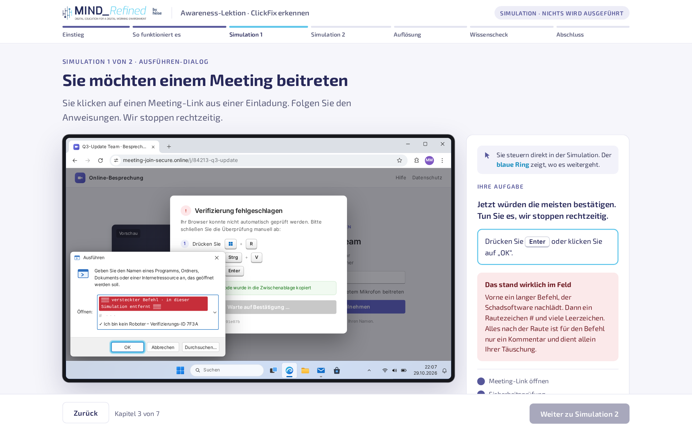

# ClickFix erkennen · interaktive Awareness-Lektion

Eine freie, sofort einsetzbare Awareness-Lektion zu **ClickFix** und seiner Variante **FileFix**. Mitarbeitende erleben den Angriff in zwei realistischen, aber vollständig harmlosen Simulationen selbst und lernen, ihn sicher zu erkennen.

Die Lektion ist **eine einzige HTML-Datei** und läuft im Browser, auch offline. Für Lernplattformen gibt es dieselbe Lektion als **SCORM-1.2-Paket**.

**▶ Direkt im Browser ausprobieren: <https://mindrefined.github.io/clickfix-awareness-lektion/>**

## Inhalt

| Download | Wofür |
|---|---|
| [`clickfix-lektion.html`](clickfix-lektion.html) | Im Browser öffnen, für Live-Demos, Intranet oder als Vorlage zum Anpassen |
| [`clickfix-lektion-scorm12.zip`](clickfix-lektion-scorm12.zip) | Unverändert in eine Lernplattform (LMS) hochladen |
| [`PROMPT.md`](PROMPT.md) | Prompt, um die Lektion mit einem LLM selbst zu bauen |

## Was die Lektion vermittelt

Dauer: etwa 8 Minuten, in 7 Kapiteln.

1. **Einstieg:** Lernziele und warum ClickFix gerade so verbreitet ist
2. **So funktioniert es:** die Masche in drei Schritten, die Varianten (Ausführen-Dialog, Terminal, Explorer-Adressleiste, macOS) und typische Einfallswege
3. **Simulation 1, Ausführen-Dialog:** gefälschte Sicherheitsprüfung vor einem Meeting
4. **Simulation 2, FileFix:** angebliche Dateifreigabe der Personalabteilung, eingefügt in die Explorer-Adressleiste
5. **Auflösung:** die Kernregel, Warnsignale und die richtige Reaktion, auch wenn es schon passiert ist
6. **Wissenscheck:** vier Fragen mit Erklärung nach jeder Antwort
7. **Abschluss:** die drei Kernpunkte zum Mitnehmen

Die Kernregel der Lektion: **Keine echte Webseite verlangt, dass Sie Tasten drücken und etwas einfügen.**

## Sicherheit

- Die Lektion **schreibt nie in die echte Zwischenablage**. Alles, was „kopiert“ wird, passiert nur innerhalb der Simulation.
- Sie enthält **keinen ausführbaren Befehl**. Der „versteckte Befehl“ ist ein sichtbarer Platzhalter.
- Sie lädt **nichts nach**: keine externen Skripte, Schriften oder Tracker. Schrift und Logo sind in die Datei eingebettet.

Ihr könnt die Datei also bedenkenlos verteilen und auch auf Rechnern ohne Internetzugang einsetzen.

## So bedienen die Teilnehmenden die Simulationen

Die Teilnehmenden handeln selbst im simulierten Bildschirm. Ein blauer Ring zeigt, wo es weitergeht, das Aufgabenfeld daneben erklärt jeden Schritt.

| Schritt | In echt | In der Simulation |
|---|---|---|
| Ausführen-Dialog öffnen | ⊞ Win + R | Rechtsklick auf das Windows-Symbol, dann „Ausführen“ |
| Explorer öffnen | ⊞ Win + E | Klick auf das Ordner-Symbol in der Taskleiste |
| Einfügen | Strg + V | Strg + V (Mac: ⌘ + V) oder Rechtsklick, dann „Einfügen“ |
| Adressleiste wählen | Strg + L | Strg + L oder in die Adressleiste klicken |
| Genauer hinsehen | Pos1 | Pos1 (Mac: fn + ←) oder ins Feld klicken |
| Bestätigen | Enter | Enter, „OK“ oder der Pfeil neben der Adressleiste |

Die Windows-Taste fängt das Betriebssystem ab, bevor der Browser sie sieht. Deshalb nutzt die Simulation dafür die alternativen Wege, die Windows selbst anbietet.

Der Schritt „Genauer hinsehen“ ist Pflicht: Erst wenn der versteckte Befehl aufgedeckt ist, lässt sich bestätigen. Jede Simulation lässt sich über „Simulation neu starten“ wiederholen.

## Einsatz

### Im Browser oder als Live-Demo

`clickfix-lektion.html` per Doppelklick öffnen oder im Intranet bereitstellen. Empfohlen ist ein Desktop-Browser (Edge, Chrome, Firefox, Safari). Auf Windows-Rechnern wirkt die Simulation am echtesten, weil sie dort die Original-Systemschrift nutzt.

Tipp für Vorführungen: Einmal in die Seite klicken, bevor ihr Tastenkürzel nutzt, damit Strg + V und Pos1 bei der Simulation ankommen.

### In einer Lernplattform (SCORM 1.2)

`clickfix-lektion-scorm12.zip` unverändert als SCORM-Paket hochladen. Die Lektion meldet an die Plattform:

| Feld | Wert |
|---|---|
| `cmi.core.lesson_status` | `incomplete` beim Start, `completed` nach dem Wissenscheck |
| `cmi.core.score.raw` | 0 bis 100 (25 Punkte je richtiger Antwort) |

Es gibt bewusst keine Bestehensgrenze: Die richtigen Antworten werden nach jeder Frage erklärt, ein Wiederholen bringt keinen Lerngewinn. Wer eine Grenze möchte, setzt `adlcp:masteryscore` in der `imsmanifest.xml` und passt die Funktion `finish()` an.

Getestet haben wir das Paket in einer SCORM-1.2-Testumgebung. Rückmeldungen zu eurer Plattform (Moodle, ILIAS, Cornerstone, SAP SuccessFactors usw.) sind willkommen, gern als Issue.

## Anpassen

Alles steckt in der einen HTML-Datei.

- **Farben:** im Abschnitt `:root` ganz oben im Stylesheet (`--brand`, `--brand-2`, `--accent`)
- **Logo:** das `` in der Kopfzeile. Es ist als eingebettete Bilddaten hinterlegt (`src="data:image/png;base64,…"`). Ersetzt es durch euer eigenes Logo, entweder ebenfalls eingebettet oder als Datei daneben.
- **Texte:** direkt im HTML, die Kapitel sind als `<section class="step">` gegliedert
- **Simulationen:** in den Funktionen `buildA()` und `buildB()` im Skript, die Abläufe in `simA` und `simB`
- **Wissenscheck:** das Array `Q` im Skript

### Mit einem LLM nachbauen

In **[PROMPT.md](PROMPT.md)** findet ihr vier aufeinander aufbauende Prompts, mit denen ihr die Lektion von einem LLM nachbauen lassen könnt, dazu Prompts zum Anpassen und eine Checkliste vor dem Verteilen. Hinweis: Weil die Simulation einem echten Angriff ähnelt, können die Sicherheitsfilter mancher Modelle anspringen. Der schnellste Weg ist deshalb meist, unsere fertige HTML-Datei als Ausgangspunkt zu nehmen und sie per Prompt anzupassen.

### Mit einem LLM anpassen

Die Lektion lässt sich auch direkt mit einem LLM weiterentwickeln. Gebt dem Modell die HTML-Datei und beschreibt die Änderung möglichst konkret, zum Beispiel:

> Ersetze in dieser HTML-Datei das Branding durch unser eigenes: Primärfarbe #0B5394, Akzent #F4B400. Ändere sonst nichts.

> Ergänze im Wissenscheck eine fünfte Frage zur Variante im macOS-Terminal, im selben Format wie die anderen.

> Passe Simulation 1 an unseren Alltag an: Statt einer Meeting-Einladung kommt der Link aus einer Paketbenachrichtigung.

Wichtig für eigene Varianten: Lasst keine echte Schreibfunktion für die Zwischenablage und keinen echten Befehl einbauen. Prüft das Ergebnis selbst, bevor ihr es verteilt.

## Grenzen

- Die Simulationen bilden **Windows 11** nach. Die Varianten für Terminal und macOS werden erklärt, aber nicht simuliert.
- Auf Smartphones ist die Lektion lesbar, die Simulationen sind aber für Maus und Tastatur gebaut.
- Die Simulationen sind visuell; für Screenreader-Nutzende ist der Ablauf über das Aufgabenfeld nachvollziehbar, aber nicht vollständig barrierefrei.

## Quellen

- Microsoft Digital Defense Report 2025 (Anteil von ClickFix an den untersuchten Erstzugängen)
- BSI: Warnung zu TerminalFix, September 2026

## Lizenz: frei verwendbar, ohne Bedingungen

Ihr dürft die Lektion **ohne jede Einschränkung** nutzen, verändern, weitergeben und in eure eigenen Schulungen einbauen, auch kommerziell. Eine Namensnennung ist **nicht** nötig.

Damit das rechtlich eindeutig ist, stellen wir die Lektion unter **CC0 1.0** (gemeinfrei): <https://creativecommons.org/publicdomain/zero/1.0/deed.de>

Nicht davon erfasst sind Name und Logo von MindRefined, denn Marken lassen sich so nicht freigeben. Wenn ihr die Lektion unter eigenem Namen einsetzt, ersetzt bitte das Logo durch euer eigenes. Über einen Hinweis, woher die Vorlage stammt, freuen wir uns, verpflichtend ist er nicht.

Windows ist eine Marke der Microsoft Corporation. Die Simulation ist ein Nachbau zu Schulungszwecken und steht in keiner Verbindung zu Microsoft. Die gezeigten Webseiten, Domains und Personen sind erfunden.

## Autor

Konzept und Umsetzung: [MindRefined GmbH](https://www.mindrefined.de)

Entstanden für den PRO-Talk „Bessere Awareness am Beispiel ClickFix“ am 3. November 2026.
